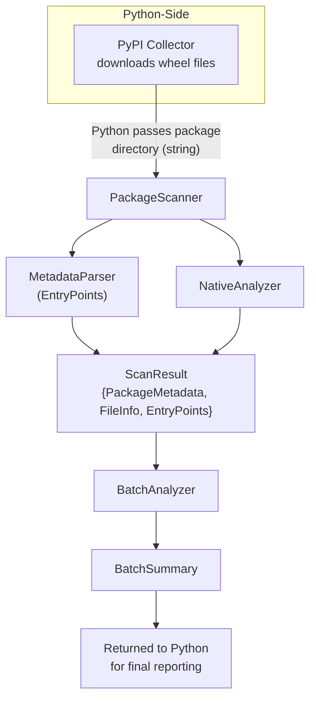
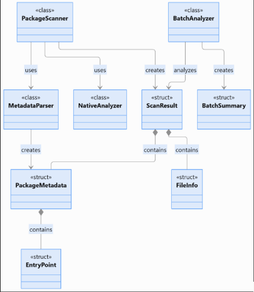

# Python Package Scanner — System Design

**CS 3460 Modern C++ · Project 4 · Milestone 3: System Design for Refactoring**
Team: Logan Baker (lead), Kolton Freeman, Zack Zollinger

## Overview

This document describes the proposed design for a small Python package metadata analyzer. The program takes a text file of line-separated Python package names, downloads and scans 100 of those packages, and reports statistics for all the analyzed packages at the end. These statistics include the number of declared dependencies, packages with entry points, packages with native files, native files, native bytes, and the total number of Python, native-library, metadata, and data/other files.

The Python code is responsible only for collecting and extracting the wheels, calling the C++ module, and reporting the values that the C++ code returns. All parsing and analysis happens in C++. This design covers the main requirements of the program, the class structure, and the tests that will verify a correct implementation in the next milestone.

---

## 1. Requirements

The requirements below split the functionality of the package scanner into smaller testable parts. They are referred to by ID throughout this design.

| ID | Description |
|----|-------------|
| **R1** | Given a wheel that Python has downloaded and extracted, scan it for its metadata. This metadata includes items such as package name, version, and Python version requirements. |
| **R2** | Scan the metadata of the extracted wheel for all declared dependencies that each Python package has. |
| **R3** | Scan the metadata and extract the entry points for each Python package. |
| **R4** | Count the native files and bytes contained within each extracted wheel, ignoring those which are non-native Python files. |
| **R5** | Accept the results of all the wheel scans and then create a simple batch analysis of the metadata found from all of them as a result. |
| **R6** | Store the individual metadata findings from all wheels in a JSON file (`results.json`). Using the batch analysis, report the overall statistics in a clean, interpretable format, including the Milestone 1 totals for Python, native-library, metadata, and data/other files. Keep the Milestone 1 outputs: `manifest.json` records the project, version, and wheel filename for each package, and the run prints an inventory sample (relative path, category, size) for the first scanned package. Python only serializes and prints values returned by C++; it does not reopen package files, classify files, or recompute statistics. |
| **R7** | Inventory every regular file in an extracted wheel exactly once, with its path relative to the wheel root and its size in bytes, and classify it as `Metadata` (inside a `.dist-info` directory, checked first), `Python` (`.py`), `NativeLibrary` (`.so`, `.pyd`, `.dll`, `.dylib`), or `DataOther`. |
| **R8** | Handle bad input without stopping the batch: a package with no `METADATA` file produces empty metadata fields, a missing extraction directory raises an error, and a wheel that fails to extract or scan is reported and skipped while the rest of the batch continues. |

Below on the left is an example of the record stored for each individual wheel in `results.json`, using the Milestone 2 format. On the right is an example of the final batch report once the program has finished.

| Example metadata stored in JSON | Example final batch summary |
|---|---|
| <pre>[<br>  {<br>    "name": "example-pkg",<br>    "version": "1.4.2",<br>    "requires_python": ">=3.10",<br>    "dependencies": ["requests>=2.31"],<br>    "entry_points": [<br>      {"group": "console_scripts",<br>       "name": "example-tool",<br>       "target": "example_pkg.cli:main"}<br>    ],<br>    "total_files": 54,<br>    "total_bytes": 183420,<br>    "native_count": 0,<br>    "native_bytes": 0<br>  },<br>  ...<br>]</pre> | <pre>Packages analyzed: 100<br>Declared dependencies: 701<br>Packages with entry points: 28<br>Packages with native files: 9<br>Native files: 33<br>Native bytes: 53765892<br><br>Python files: 6120<br>Native libraries: 33<br>Metadata files: 512<br>Data/other files: 1904<br>Results written to: results.json</pre> |

---

## 2. System Design

The overall structure of the system consists of four main C++ classes that divide the work into individual parts: **PackageScanner**, **MetadataParser**, **NativeAnalyzer**, and **BatchAnalyzer**. A few plain structures hold the data passed between those classes and returned to Python, so each class and structure has a clearly defined purpose.

The current code is a set of free functions (`scan_directory()`, `parse_metadata()`, `parse_entry_points()`, `summarize_batch()`), with the native-file counting written inline inside `scan_directory()`. The refactor moves each responsibility into its own class while keeping the two functions Python calls, `scan_directory()` and `summarize_batch()`, as thin wrappers. This means the Python loop keeps calling the same two functions, and the only change to the pybind11 bindings is exposing the three new `BatchSummary` fields described in 2.1.



*Figure 1. System overview: how a package moves from the Python collector through the C++ classes and back to Python.*

### 2.1 Data structures

These structures are carried over from Milestone 2, with three new `BatchSummary` fields, so the pybind11 bindings and the JSON output stay stable. They hold data only and have no behavior.

```cpp
enum class FileType { Python, NativeLibrary, Metadata, DataOther };

struct FileInfo {
    std::string path;          // relative to the wheel root
    FileType type{};
    std::uint64_t size{};
};

struct EntryPoint {
    std::string group;
    std::string name;
    std::string target;
};

struct PackageMetadata {
    std::string name;
    std::string version;
    std::string requires_python;            // empty when absent
    std::vector<std::string> dependencies;  // every Requires-Dist value
    std::vector<EntryPoint> entry_points;
};

struct ScanResult {
    std::vector<FileInfo> files;
    std::uint64_t total_bytes{};
    PackageMetadata metadata;
    std::uint64_t native_count{};
    std::uint64_t native_bytes{};
};

struct BatchSummary {
    std::size_t packages{};
    std::size_t declared_dependencies{};
    std::size_t packages_with_entry_points{};
    std::size_t packages_with_native_files{};
    std::uint64_t native_files{};      // also the NativeLibrary category total
    std::uint64_t native_bytes{};
    std::size_t python_files{};        // Milestone 1 category totals
    std::size_t metadata_files{};
    std::size_t data_other_files{};
};
```

`BatchSummary` keeps every Milestone 2 field and adds three Milestone 1 category totals, which are also exposed through the pybind11 bindings. `native_files` already counts `NativeLibrary` files, so it doubles as the fourth category total. This moves the file-type counting that `batch_reporter.py` does today into C++.

Each scanned package gets one `ScanResult`, which groups everything learned about that package: its `FileInfo` inventory, its `PackageMetadata` (including `EntryPoint` values), and its native statistics.

### 2.2 Class diagram



*Figure 2. UML class diagram. Labeled arrows show usage (uses, creates, analyzes); filled diamonds show composition (contains).*

`PackageScanner` uses one `MetadataParser` and one `NativeAnalyzer`, which it holds as members and reuses for every package, and it creates one `ScanResult` per package. The parser and analyzer never talk to each other; both only read the `FileInfo` inventory that the scanner builds. `BatchAnalyzer` is independent of the scanner: it only analyzes finished `ScanResult` values and creates the `BatchSummary`. Each `ScanResult` contains its `PackageMetadata` (created by `MetadataParser`) and its `FileInfo` list, and `PackageMetadata` contains the package's `EntryPoint` values. This keeps the dependencies one-directional, so each class can be tested on its own.

### 2.3 Classes and responsibilities

#### PackageScanner (R7, R8)

`PackageScanner` coordinates the scan of one extracted wheel. It is the only class that touches the directory structure: it walks the extracted wheel once with `std::filesystem::recursive_directory_iterator`, classifies each file, and records its relative path and size. It then hands that inventory to `MetadataParser` and `NativeAnalyzer`, and combines their outputs into a single `ScanResult`.

```cpp
class PackageScanner {
private:
    MetadataParser metadata_parser;
    NativeAnalyzer native_analyzer;

    std::vector<FileInfo> buildInventory(const std::string& root) const;
    static FileType classify(const std::filesystem::path& relative);

public:
    // Throws std::runtime_error if root does not exist or is not a directory.
    ScanResult scan(const std::string& root);
};

// Kept for pybind11 so the Python API does not change.
ScanResult scan_directory(const std::string& dir_path);
```

The classification and traversal code moves from the current free functions into `classify()` and `buildInventory()` with two corrections:

- `classify()` receives the path **relative** to the wheel root. The current code passes the absolute path, so a temporary directory with `.dist-info` anywhere in its name would cause every file to be marked as metadata.
- Paths are stored with `generic_string()`, so Windows and Linux both produce `/`-separated paths in `FileInfo::path` and `results.json`.

Because the scanner owns all directory access, the other classes only need the inventory, and the directory is walked exactly once per package, as Milestone 2 requires.

#### MetadataParser (R1, R2, R3)

The `MetadataParser` class will be responsible for extracting package metadata, dependencies, and entry points from an extracted Python wheel, satisfying requirements R1, R2, and R3. This includes the package name, version, required Python version, declared dependencies, and entry point information.

Currently, the program uses two separate functions, `parse_metadata()` and `parse_entry_points()`. During refactoring, these functions will become methods of the `MetadataParser` class while preserving their existing parsing logic.

The public `parse()` method will accept the package's root directory and a vector of `FileInfo` objects. It will locate the `METADATA` file within the package's `.dist-info` directory and extract fields such as `Name`, `Version`, `Requires-Python`, and `Requires-Dist`. It will also call a private `parseEntryPoints()` method to read `entry_points.txt`, identify entry point groups, and extract their names and targets.

The extracted information will be stored in a `PackageMetadata` structure and returned to `PackageScanner`, which will include it in the overall `ScanResult`.

The class will not require persistent data members because all necessary information is passed through method parameters. This design encapsulates related parsing operations, separates them from package scanning, and allows the metadata extraction logic to be tested independently.

```cpp
class MetadataParser {
private:
    std::vector<EntryPoint> parseEntryPoints(const std::string& path);
public:
    PackageMetadata parse(const std::string& root,
                          const std::vector<FileInfo>& files);
};
```

#### NativeAnalyzer (R4)

The `NativeAnalyzer` class will define how the statistics about native files are stored and used. Some of the extracted Python package wheels will correspond to native Python packages, and others will not. The `FileInfo` structure holds the information necessary to determine which files are native library files. For each scanned package, the `NativeAnalyzer` object owned by `PackageScanner` will determine and store the number of native files and their size in bytes. Because the same object is reused for every package, `analyze()` resets `native_count` and `native_bytes` to zero before counting, so values never carry over from a previous package.

The data stored in this class will be used by the `PackageScanner` class to fill in the native statistics of each scanned package. The individual statistics will be stored in `ScanResult` structures, which will be created for each scanned package.

```cpp
class NativeAnalyzer {
private:
    uint64_t native_count = 0;
    uint64_t native_bytes = 0;
public:
    void analyze(const std::vector<FileInfo>& files);
    uint64_t get_native_count() const;
    uint64_t get_native_bytes() const;
};
```

#### BatchAnalyzer (R5)

The `BatchAnalyzer` class will gather the statistics from each scanned package which will be contained in the `ScanResult` structures. Each scanned Python package will have a corresponding `ScanResult` to hold the data collected about it. It is a convenient way to organize information gathered about a single package from multiple structures, namely `PackageMetadata`, `FileInfo`, and `EntryPoint`, as seen in the diagram above.

Since the file statistics will be in separate structures for each of the 100 scanned packages, `BatchAnalyzer` will combine this information from the `ScanResult` structures to form overall counts and statistics for the packages, including the number of Python, metadata, and data/other files from each package's `FileInfo` list. Then, `BatchAnalyzer` will use those statistics to place into a neatly formatted `BatchSummary` structure. This `BatchSummary` will contain all the collected information needed for the detailed final statistical report.

```cpp
class BatchAnalyzer {
public:
    BatchSummary summarize_batch(const std::vector<ScanResult>& results);
};
```

The current code structure has the responsibilities of the `BatchAnalyzer` and `NativeAnalyzer` combined and spread throughout several functions and files. This design will help simplify the code and organize it in a simpler way. A single function to collect the info from a vector of `ScanResult` values will allow `BatchAnalyzer` to create the final `BatchSummary`. Similarly, `NativeAnalyzer` will contain all the logic needed for examining the native files within those native Python packages.

#### Python side (R6, R8)

Python keeps its role from earlier milestones but is organized into three parts instead of one large `main()`:

| Python component | Responsibility |
|---|---|
| `PyPICollector` (`pypi_collector.py`) | Read package names, query the PyPI JSON API, choose and download one wheel per project into `wheelhouse/`, and write `manifest.json` with the project, version, wheel filename, and URL of each package. |
| `scan_wheel(path)` | Extract one wheel into a `tempfile.TemporaryDirectory`, call `package_scanner.scan_directory()`, and return the `ScanResult` while the directory still exists. |
| `BatchReporter` (`batch_reporter.py`) | Print the inventory sample for the first scanned package from its `ScanResult::files`, convert each bound `ScanResult` into a JSON record, write `results.json`, call `package_scanner.summarize_batch()`, and print the returned `BatchSummary`, including the category totals. It no longer counts file types itself. |

Each scan call is wrapped in a `try/except`, so one bad wheel is logged and skipped while the batch continues (R8). Two changes from the current script: it will write `results.json` (today it only writes `manifest.json`), and it will keep the `wheelhouse/` folder instead of deleting it, so tests and graders can rerun scans without downloading again.

### 2.4 Class interactions

Figure 1 shows the flow described below.

**Scanning one package.** The Python loop extracts a wheel into a temporary directory and calls `scan_directory(tmp)`. `PackageScanner::scan()` checks that the directory exists, then builds the inventory: one `FileInfo` per file, classified, with `total_bytes` summed along the way. The scanner passes the root and inventory to `MetadataParser::parse()`, which finds `METADATA` and `entry_points.txt` in that inventory, parses them, and returns a `PackageMetadata`. Next, the scanner passes the same inventory to `NativeAnalyzer::analyze()` and reads the results through `get_native_count()` and `get_native_bytes()`. The scanner places all of this into one `ScanResult` and returns it to Python. Python keeps that `ScanResult` after the temporary directory is deleted, because it holds its own copies of all the data.

**Summarizing the batch.** After every package has been scanned, Python passes the list of `ScanResult` values to `summarize_batch()`. `BatchAnalyzer` totals the dependencies, entry points, native statistics, and file-type counts and returns a `BatchSummary`. Python writes each `ScanResult` to `results.json` and prints the `BatchSummary`, so every number in the report is computed in C++.

### 2.5 How the design satisfies the requirements

| Requirement | Satisfied by |
|---|---|
| R1 Package metadata | `MetadataParser::parse()` reads `Name`, `Version`, `Requires-Python` from `METADATA`. |
| R2 Dependencies | `MetadataParser::parse()` appends every `Requires-Dist` value. |
| R3 Entry points | `MetadataParser::parseEntryPoints()` reads `entry_points.txt` when present. |
| R4 Native statistics | `NativeAnalyzer::analyze()` reads `NativeLibrary` entries from the inventory. |
| R5 Batch analysis | `BatchAnalyzer::summarize_batch()` produces `BatchSummary`, including the file-type totals. |
| R6 JSON and report | Python `BatchReporter` serializes `ScanResult` values, prints the inventory sample and `BatchSummary` (including category totals); `PyPICollector` writes `manifest.json`. |
| R7 Inventory and classification | `PackageScanner::buildInventory()` and `classify()`. |
| R8 Error handling | `PackageScanner::scan()` validates the root; parser returns empty metadata if files are missing; Python loop skips failed packages. |

---

## 3. Test Design

These tests are designed around the class structure and requirements above. C++ classes will be tested with a small C++ test executable registered with CTest, and the Python side with `pytest`. Tests use small hand-built fixture directories under `tests/fixtures/` with known file names, sizes, and contents, so the results can be compared exactly. Only T7 needs network access.

| Test | Target / Setup | Expected Result |
|---|---|---|
| **T1 — Metadata extraction (R1)** | Provide a package containing a valid `METADATA` file with a name, version, and required Python version. | The `MetadataParser` correctly extracts and stores all three fields in the `PackageMetadata` structure. |
| **T2 — Dependency extraction (R2)** | Provide a package containing multiple `Requires-Dist` entries in its metadata. | All declared dependencies are correctly extracted and stored in the `dependencies` vector. |
| **T3 — Entry point extraction (R3)** | Provide a package containing an `entry_points.txt` file. | All valid entry points are extracted with the correct group, name, and target. Comments and blank lines are ignored. |
| **T4 — Native statistics (R4)** | Provide `NativeAnalyzer` with a small group of `FileInfo` structures with known numbers of native files and file sizes. | Create accurate counts for native files and their corresponding byte sizes. |
| **T5 — Batch statistics (R5)** | Provide `BatchAnalyzer` with a few `ScanResult` structures with known values of entry points, dependencies, and native files and sizes. | Create a correct `BatchSummary` containing the pre-determined number of packages scanned, entry points, dependencies, and native statistics. |
| **T6 — Final report (R6)** | Run the Python batch on 3 local fixture wheels (no network) using `pytest`'s `tmp_path`, and capture standard output. | `results.json` loads as valid JSON and holds exactly 3 records. Each record has name, version, requires_python, dependencies, entry_points, total_files, total_bytes, native_count, and native_bytes, matching the C++ `ScanResult` values. The printed totals, including the four category totals, equal the `BatchSummary` fields, and an inventory sample showing relative path, category, and size is printed for the first package. |
| **T7 — End to end (R1–R8)** | Provide the Python program with a text file of package names and run the full collection and scan. | 100 wheels from 100 distinct projects are in `wheelhouse/`; `manifest.json` and `results.json` each hold 100 records; the printed totals equal the sums over those records. |
| **T8 — Inventory and classification (R7)** | Call `scan()` on a fixture containing `pkg/__init__.py` (100 B), `pkg/_core.so` (1000 B), `pkg/data.json` (50 B), `pkg-1.0.dist-info/METADATA`, and `pkg-1.0.dist-info/hook.py`. | 5 `FileInfo` entries with `/`-separated relative paths and exact sizes; `total_bytes` equals their sum. Types: Python, NativeLibrary, DataOther, Metadata, and **Metadata** for `hook.py` (the `.dist-info` rule takes precedence over `.py`). |
| **T9 — Scanner reuse (R4, R7)** | Use one `PackageScanner` to scan a fixture with 2 native files, then a pure-Python fixture. | The second `ScanResult` reports `native_count == 0` and `native_bytes == 0`; no values carry over from the first scan. |
| **T10 — Error handling (R8)** | (a) Call `scan_directory()` on a path that does not exist. (b) Scan a fixture with no `.dist-info` folder. (c) Run the Python loop on 3 wheels where the middle file is not a valid zip. | (a) An exception is raised (`RuntimeError` in Python). (b) The scan succeeds with empty name, version, dependencies, and entry points. (c) The bad wheel is reported, and the loop returns 2 results. |

These tests will use controlled inputs that have known values for each of the key statistics the program intends to find. These are the number of entry points, dependencies, native files, and native file sizes, along with file counts, file sizes, and file-type totals. The outputs should exactly match the expected results based off of the known inputs going into the tests.

The tests designed above intend to isolate each part of the process so that a failed test can highlight specific points of failure in the program's implementation. For example, if T1–T3 pass but T8 fails, the problem is in the scanner's inventory rather than the parser. T9 checks that the `NativeAnalyzer` owned by the scanner does not keep values between packages. T6 and T7 check that the pieces work together without depending on how each class is implemented internally. Any test that fails will give valuable information for discovering issues by showing the actual and expected output, and in the final milestone each test will record its input, expected output, actual output, and pass/fail status. The proposed class structure allows for solutions to be made without requiring changes to all code files or rewriting large chunks of code.

### 3.1 Coverage

| Requirement | Tests |
|---|---|
| R1 Package metadata | T1, T7, T10(b) |
| R2 Dependencies | T2, T7 |
| R3 Entry points | T3, T7, T10(b) |
| R4 Native statistics | T4, T9 |
| R5 Batch analysis | T5, T6 |
| R6 JSON and report | T6, T7 |
| R7 Inventory and classification | T8, T9 |
| R8 Error handling | T10 |

Every requirement is covered by at least one component test, and all of them are exercised together by the end-to-end test T7.

---

## Optional Bonus — Design Pattern: Strategy

**Design problem.** In the base design, `PackageScanner` calls each analysis by name: `metadata_parser.parse(...)`, then `native_analyzer.analyze(...)` followed by two getters. Each class has a different interface, so adding a new per-package analysis (such as license detection) means adding a new member to `PackageScanner` and editing `scan()`. It also means `scan()` can only be tested by running every real analysis on real files.

**Selected pattern.** Strategy. Each per-package analysis becomes a concrete strategy behind one shared interface, `PackageAnalyzer`. `PackageScanner` becomes the context: it holds a list of analyzers and runs each one on the same inventory without knowing what any of them does. Each analyzer writes its results directly into its own fields of the `ScanResult`.

```cpp
class PackageAnalyzer {
public:
    virtual ~PackageAnalyzer() = default;
    virtual void analyze(const std::string& root,
                         const std::vector<FileInfo>& files,
                         ScanResult& result) = 0;
};

class MetadataParser : public PackageAnalyzer { /* fills result.metadata */ };
class NativeAnalyzer : public PackageAnalyzer { /* fills native_count, native_bytes */ };

class PackageScanner {
private:
    std::vector<std::unique_ptr<PackageAnalyzer>> analyzers;
public:
    PackageScanner();  // registers MetadataParser and NativeAnalyzer
    void addAnalyzer(std::unique_ptr<PackageAnalyzer> analyzer);
    ScanResult scan(const std::string& root);
};

ScanResult PackageScanner::scan(const std::string& root) {
    ScanResult result;
    result.files = buildInventory(root);
    for (const FileInfo& f : result.files) result.total_bytes += f.size;
    for (auto& analyzer : analyzers)
        analyzer->analyze(root, result.files, result);
    return result;
}
```

| Role | Class |
|---|---|
| Strategy interface | `PackageAnalyzer` |
| Concrete strategies | `MetadataParser`, `NativeAnalyzer` (plus a `FakeAnalyzer` in tests) |
| Context | `PackageScanner` |

**Expected improvement.**

- **Extension without modification.** A new analysis is one new class plus one `addAnalyzer()` call; `scan()` does not change.
- **Testability.** `PackageScanner` can be tested with a `FakeAnalyzer` that records whether it was called once with the full inventory, separately from the real parsers.
- **No stale state.** Because `NativeAnalyzer` writes its counts straight into each package's `ScanResult` instead of keeping them in data members, values cannot carry over from one package to the next (the problem T9 checks for).

`BatchAnalyzer` is not part of the pattern because it works on the whole batch, not on one package. In the final milestone, this pattern will be implemented as shown and checked by T9, a scanner test with a `FakeAnalyzer`, and the end-to-end test T7.
